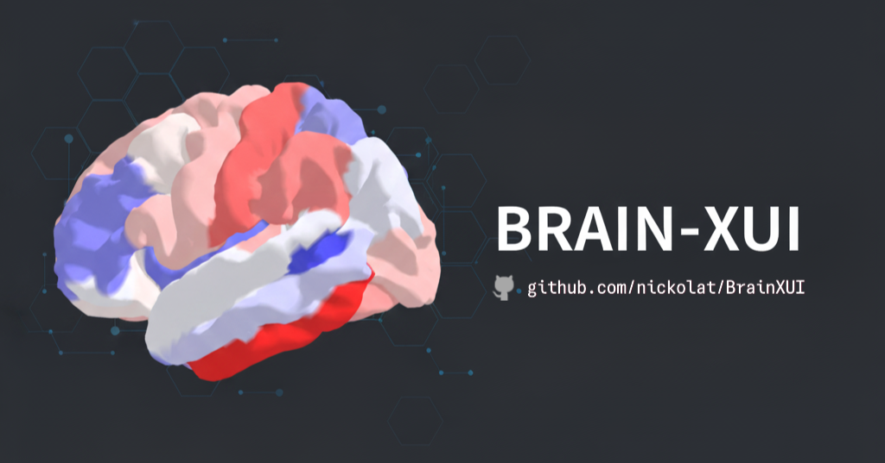

# Brain XAI Interactive 3D UI



This project involves the design and implementation of an interactive 3D interface to show 
how much the cortical areas of a patient's brain impact the prediction of an 
AI algorithm that estimates the patient's brain age from brain images.
This prediction is useful because, if the predicted brain age 
is greater than the patient's true age, there may be problems 
related to neurological diseases. Distinguishing the various 
areas allows to understand which ones are more problematic.

Specifically, the purpose of this project is to show the results of a
XAI algorithm (SHAP values) on brain regions in a way that is easily 
understood by a clinician, following the principles of human-centered design. 
So, this project falls within the field of 
**Human-Centered Artificial Intelligence** (HCAI), 
specifically **eXplainable UI** (XUI). Project Year: 2024.

## Usage

Create the virtual environment with the `requirements.txt` file
included in the repository. The Python version used is `3.12.2`.

First, put your SHAP data in the `data` folder 
according to the structure indicated in the following section. 
Then, run `save_atlas.py` and `main.py` 
and the interface will open at http://localhost:5000.

```
pip install -r requirements.txt
python save_atlas.py
python main.py 
```

## Input data

```
├─ BrainXUI/
    ├── data/
        ├── deepSHAP_data.csv
        ├── bilanciata_vol_data.csv
        ├── bilanciata_avg_th_data.csv
        ├── demo_data.csv
```

The first three csv files include respectively three types of SHAP values, 
for each patient and each brain region, according to Desikan-Killiany brain atlas.
The last csv file contains demographic data for each patient 
(participant_id, sex, age, site).


## Details

You can find implementation details in `docs/docs.md` 
and an 🇮🇹 presentation [here](https://drive.google.com/file/d/1d2v_DU18hs3qdSa7B7OER5EU7Ic2lhWA/view?usp=sharing).


## Acknowledgements

* [Nilearn](https://nilearn.github.io/stable/index.html)
* [Plotly](https://github.com/plotly/plotly.py)
* [Panel](https://github.com/holoviz/panel)
* [Abagen](https://abagen.readthedocs.io/en/stable/)

